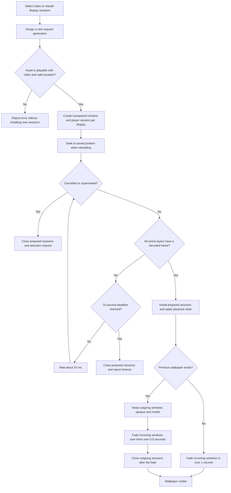
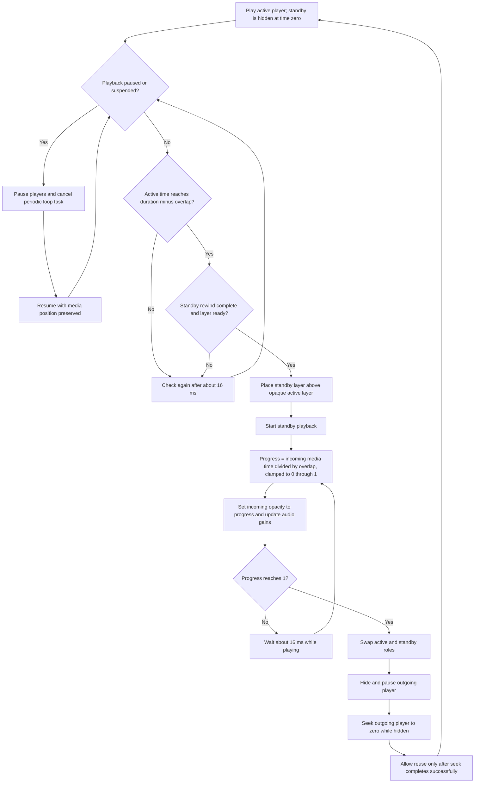

# How Loopmural's moving desktop works

This document describes the implementation in [WallpaperEngine.swift](Loopmural/WallpaperEngine.swift), with selection and persistence handled by [WallpaperLibrary.swift](Loopmural/WallpaperLibrary.swift).

## From a video file to a desktop wallpaper

Loopmural renders video in AppKit windows behind the desktop icons. It does not change the macOS wallpaper setting. The app must remain running to keep the video visible.

1. The library copies imported MP4 or MOV files into its own Application Support directory and saves metadata and thumbnails with SwiftData. Playback uses this local copy, so moving the original file does not interrupt it.
2. Selecting a video calls `WallpaperLibrary.apply`, which resolves the local file and awaits `WallpaperEngine.start`. The selected video and pause preference are saved in `UserDefaults` after startup succeeds.
3. The engine validates the asset asynchronously: it must be playable, contain a video track, and have a finite, positive duration.
4. The engine creates one `WallpaperSession` per `NSScreen`. Each session owns a window, its video layers, and its own player or pair of players.
5. An `AVPlayerLayer` renders the video using `.resizeAspectFill`, filling the display while preserving aspect ratio and cropping excess content.

The borderless window covers `screen.frame` and sits at `CGWindowLevelForKey(.desktopWindow) + 1`, above the desktop background and below desktop icons. It ignores mouse events, cannot become the key or main window, has no shadow, and stays visible when the app deactivates. Its collection behavior is `[.canJoinAllSpaces, .stationary, .ignoresCycle]`. macOS controls how these windows appear during Spaces, Mission Control, and Stage Manager transitions; the engine does not animate a desktop swipe itself.

## Smooth startup and wallpaper replacement

Asset validation is not enough to guarantee a visible frame. The engine creates incoming windows at alpha zero and waits for every session's active `AVPlayerLayer.isReadyForDisplay` before revealing them. It checks about every 20 ms, with a 10-second deadline. While preparation runs, existing sessions remain installed.

The central rule is to keep the outgoing image fully opaque underneath the incoming fade. Fading both windows out and in together would expose the background between them. Outgoing sessions continue playing unless paused or suspended, but their audio is muted immediately.

Each asynchronous startup has a generation UUID. A newer request or Stop invalidates earlier work; cancellation and generation checks prevent stale preparation from becoming active. Prepared sessions are closed if startup exits before installation.

With Reduce Motion enabled, window fade duration becomes zero. Outgoing sessions are still retained for the normal cleanup delay.

## Smooth end-to-start looping

Ordinary playback uses an `AVQueuePlayer` with `AVPlayerLooper`. The optional **Smooth Loop** setting instead creates two ordinary `AVPlayer` instances and two layers per display. One shows the current cycle while the other waits at the beginning. Players hold their final frame at the end.

The overlap is `min(0.5, duration / 4)` seconds. For a 10-second video, the blend starts near 9.5 seconds and lasts through the incoming player's first 0.5 seconds. The incoming player then continues from that position, so each subsequent cycle is shortened by the overlap.

Blend progress follows the incoming player's media time, rather than elapsed wall time. If playback stalls, the fade waits for media progress. Pausing or sleeping preserves the blend position. Layer updates disable implicit Core Animation actions so a second animation does not lag behind the calculated opacity.

During a blend, audio gains are complementary: outgoing volume is `volume * (1 - progress)` and incoming volume is `volume * progress`. Sound is disabled by default. When enabled, only the first display session outputs audio to avoid duplicate sound across displays.

Smooth Loop is disabled for newly created sessions when Reduce Motion is enabled. Changing the Smooth Loop setting rebuilds the display sessions through the same prepared-window transition described above.

## Display changes, sleep, and cleanup

| Event | Engine behavior |
| --- | --- |
| Display configuration changes | Capture the first session's playback time and the user pause state, cancel an earlier rebuild task, then prepare replacement sessions for the current screens. Each incoming player seeks to that time before reveal. |
| Display sleep, system sleep, or inactive user session | Add a suspension reason and pause playback. The saved user pause preference is unchanged. |
| Wake or active user session | Remove the corresponding suspension reason. Resume only when all reasons are cleared and the user has not paused. |
| Stop | Invalidate pending startup, cancel the rebuild task, close older retiring sessions, and fade current windows out over 0.7 seconds. The library clears the saved selection. |
| Quit | Stop playback, close retained sessions immediately, and remove observers. Preserve the saved selection and pause preference for optional restoration on next launch. |

`WallpaperSession.close()` is idempotent: it cancels loop work, removes observations, disables the looper, releases player items, detaches rendering layers, and closes the window. Player or looper failures belonging to the current generation stop playback and report an error through the library.

## Practical limits

These transitions reduce blank frames and abrupt loop seams; they cannot guarantee uninterrupted decoding or make unrelated video endpoints visually identical. A similar composition and lighting at the start and end gives the blend less visible work to do. Smooth Loop uses two players per display, and wallpaper replacement temporarily retains outgoing sessions, increasing playback resources during transitions. Displays use independent players; rebuilds restore a common position but do not implement frame-locked synchronization across monitors.
